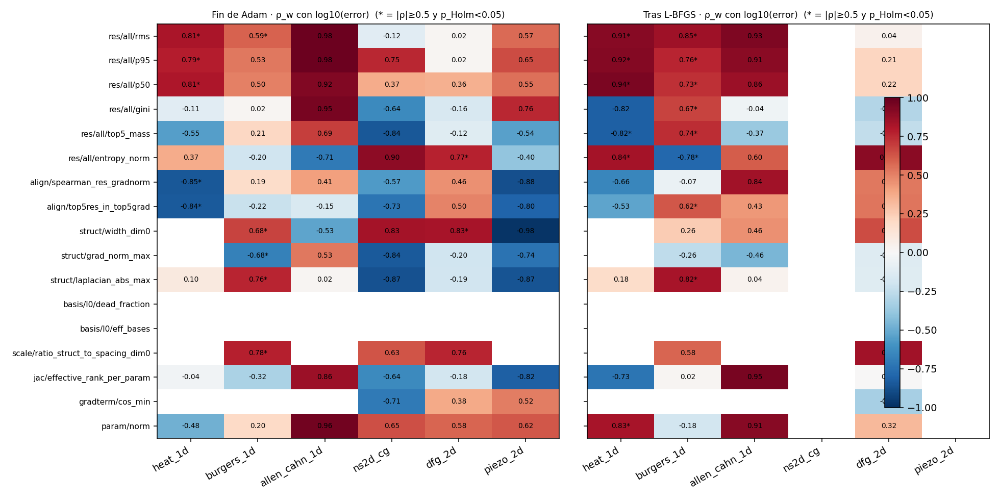

# Mecanismo de focalización con *awareness* — borrador preliminar de Métodos, Resultados y Discusión

> **Estado del borrador (2026-10-05).** Preliminar y exploratorio. Todo lo que aquí se reporta como resultado proviene de corridas exploratorias con `scientific_accepted=false`; ningún resultado ha pasado el gate `scientific_claim`. El mecanismo propuesto (EXP-0014) **todavía no se ha evaluado**: su pre-registro está sin firmar y no hay corridas. Las secciones marcadas **[PENDIENTE]** se completan con esos resultados. Las referencias bibliográficas marcadas **[VERIFICAR]** no se han contrastado con el texto completo.

---

## 1. Métodos

### 1.1 Problemas, referencias y baselines

Se estudian seis problemas: conducción de calor 1D (Heat), ecuación de Burgers viscosa 1D (ν = 0.01/π), Allen–Cahn 1D, Navier–Stokes en escalón (NS2d-CG de PINNacle), flujo estacionario alrededor de un cilindro (DFG 2D-1, Re = 20) y un bimorfo piezoeléctrico de PVDF (formulación indirecta, voltaje impuesto). Las referencias son: solución analítica (Heat); Cole–Hopf evaluada con cuadratura de Gauss–Hermite de orden 128 en una malla de 1025×129 (Burgers); el archivo `Allen_Cahn.mat` de DeepXDE (Allen–Cahn); la solución COMSOL `ns_0_obstacle.dat` (NS2d-CG); un campo de elementos finitos Taylor–Hood P2/P1 anclado a los valores del benchmark FEATFLOW (DFG), aceptado como referencia de trabajo; y un campo de elementos finitos P2 del grupo que publica el PINN de referencia, con la convención de polarización `poling_sign = −1` (piezo; sin contraste independiente).

Los baselines de este trabajo se congelaron como `baseline_v1_exploratory` (2026-10-03) y `baseline_v2_exploratory` (2026-10-04), exploratorios y sin umbrales derivados. Se reportan siempre **dos etapas** —fin de Adam y tras L-BFGS— y nunca se mezclan.

| Problema             | Referencia                  | Control RBF                                                 | Fin de Adam (L2 rel.)        | Tras L-BFGS (L2 rel.)                       |
|:---------------------|:----------------------------|:------------------------------------------------------------|:-----------------------------|:--------------------------------------------|
| Heat 1D              | analítica                   | RBF, 3 648 par., centros [−1.05,1.05], σ=0.21, float64      | 2.2e-4 ± 1.8e-4              | 1.86e-6 ± 1.8e-7                            |
| Burgers 1D           | Cole–Hopf (GH128, 1025×129) | RBF48, 29 376 par., σ=0.35, 8–16 k puntos Sobol             | 5.4e-3 ± 2.0e-3 (v2)         | 7.2e-5 ± 4.8e-5 (v2); MLP 1.05e-4 ± 2.2e-5  |
| Allen–Cahn 1D        | `Allen_Cahn.mat` (DeepXDE)  | RBF16, σ=0.35, float32                                      | 2.84e-2 ± 7.4e-3             | 2.69e-3 ± 9.5e-4; MLP 1.77e-2 ± 8.7e-3      |
| NS2d-CG              | COMSOL (12 910 nodos)       | RBF56 (40 992 par.), float32                                | 0.0655 ± 0.0058 (L2RE plano) | no corrido; MLP 0.0977 ± 0.0067             |
| DFG 2D-1 Re=20       | FEATFLOW (QoI) y FEM L3     | RBF 2-16-16-3, cohortes 301–305 y 501–505                   | —                            | error de Cd 8.2 % y 6.2 %; Δp 9.9 % y 7.3 % |
| Piezo (bimorfo PVDF) | FEM P2, `poling_sign=−1`    | RBF16 (5 376 par.), receta de la referencia, float64, n = 5 | u/v/φ: 0.092/0.104/0.048     | sin L-BFGS; MLP 0.136/0.186/0.046           |

### 1.2 Arquitectura base: RBF-PIKAN

El modelo base es una red de Kolmogorov–Arnold con funciones de arista de base radial. Con entrada normalizada $\tilde{x} \in [-1,1]^d$, cada capa $\ell$ calcula, para cada salida $o$,
$$
y_o^{(\ell)} \;=\; \sum_{i} \Big[ \sum_{g=1}^{G} c^{(\ell)}_{o,i,g}\, \exp\!\Big(-\big(\tfrac{h_i - \mu_g}{\sigma}\big)^2\Big) \;+\; b^{(\ell)}_{o,i}\,\mathrm{SiLU}(h_i) \Big],
$$
con $G = 11$ bases por arista, centros $\mu_g$ **fijos** y equiespaciados, ancho común $\sigma$ y coeficientes $c, b$ entrenables. Entre capas se aplica $\tanh$ y la capa final es lineal. Las arquitecturas usadas son $[d,w,w,k]$ con ancho $w \in \{16, 48, 56\}$ según el problema. En Heat, Burgers y Allen–Cahn la condición inicial y las de frontera se imponen por transformación dura del tipo $u = u_0(x) + (\text{factor}) \cdot t \cdot \mathrm{NN}(x,t)$.

**Nota de reproducibilidad.** El ancho y el rango de centros no son únicos entre las familias de código: el modelo de Heat usa centros en $[-1.05, 1.05]$ y $\sigma = 0.21$; los demás usan centros en $[-1,1]$ y $\sigma = 1.75\,\Delta\mu = 0.35$ (con 11 bases). Se declara por problema en la tabla de la Sección 1.1 y en el apéndice.

### 1.3 Protocolo de entrenamiento y evaluación

Los puntos de colocación se generan con secuencias de Sobol con scrambling y se comparten entre brazos para una misma semilla. El entrenamiento usa Adam ($\mathrm{lr} = 10^{-3}$, lote completo) seguido de L-BFGS con búsqueda de línea strong-Wolfe, en bloques de 25 iteraciones con parada por plateau, por tope de iteraciones o por tope de tiempo. La unidad de dispersión son las **semillas** (n = 5), no los puntos de la malla; las comparaciones entre brazos son **pareadas por semilla**. El error es el L2 relativo contra la referencia, calculado en un paso de puntuación separado del entrenamiento. El entrenamiento nunca lee la referencia.

### 1.4 Estructura proposer / verifier y pre-registro

El trabajo sigue una arquitectura donde un proposer escribe mecanismos y experimentos y un verificador de solo lectura (`evals/`) define cómo se puntúa. Los experimentos de mecanismo se pre-registran (hipótesis, brazos, semillas, criterio y condición de falsación) **antes** de ejecutarse, y la firma del pre-registro es del investigador. Un agente puede proponer; solo el investigador puede aceptar una referencia, un baseline o un claim.

### 1.5 Estudio diagnóstico de las corridas (EXP-0013)

**Objetivo.** Antes de elegir un mecanismo por razonamiento teórico, se diagnosticó qué hace cada corrida y qué señales, calculables **sin la referencia**, informan dónde y cuándo falla el modelo. La pregunta que guía el proyecto es si el mecanismo puede decidir por sí mismo dónde concentrar el esfuerzo (*awareness*), en contraste con la focalización sobre zonas indicadas por una regla fija.

**Universo.** 248 checkpoints de los controles y de los brazos pareados (RBF y perceptrón multicapa) en los seis problemas, en las etapas de fin de Adam y tras L-BFGS cuando existen (NS2d-CG y piezo solo tienen Adam). Se registró hash, campaña, brazo, semilla y etapa de cada uno.

**Separación estricta entre señales y etiquetas.** Una *señal* es una cantidad calculable durante el entrenamiento y sin referencia; una *etiqueta* requiere la referencia (error de campo, error por región). Las etiquetas nunca entran como característica en la decisión de un mecanismo: solo son la variable a explicar. Los cálculos se hicieron en módulos separados (`signals.py`, que no puede importar la referencia, y `labels.py`).

**Señales.** Sobre una malla de coordenadas del problema (solo coordenadas) y con el modelo en float64: (i) estadísticas del residuo de la PDE por punto —RMS, percentiles, coeficiente de Gini, masa en el 1 % y 5 % superior, entropía normalizada, curtosis—; (ii) estructura de la solución del propio modelo —máx. de $\|\nabla u\|$, de $|\Delta u|$, anchura de estructura $w_i = 2\max|u| / \max|\partial_{x_i} u|$ y su razón con el espaciado de las bases de la capa 0—; (iii) alineación entre residuo y estructura (correlación de Spearman y solape de los conjuntos superiores); (iv) ocupación de bases, bases muertas, número efectivo de bases; (v) rango efectivo del jacobiano; (vi) normas y cosenos de gradiente por componente residual; (vii) señales propias de cada problema (decaimiento de energía, antisimetría, caudal, tensiones constitutivas); (viii) señales de entrenamiento registradas (pérdida final, pendiente, ganancia en el último 20 % de Adam, razón L-BFGS/Adam). En total, 272 señales distintas.

**Etiquetas.** Error relativo L2 por componente y normalizado, concentración del error (Gini, masa en el 5 % superior), y masa del error y del residuo en regiones definidas con la referencia (el 5 % de mayor gradiente, interfaz, cercanía al cilindro, capas, etc.). La **alineación residuo–error** se audita con Spearman y con el solape de los conjuntos del 5 % superior (0.05 por azar).

**Análisis estadístico (pre-registrado).** Dentro de cada par (problema, etapa) se calcula una correlación de rangos centrada por semilla, $\rho_w$, entre cada señal y $\log_{10}$ del error. La significación se evalúa con una permutación **dentro de cada bloque de semilla** (hasta 5 000 permutaciones, con parada temprana) para respetar la dependencia entre corridas que comparten puntos y arranque, con corrección de Holm por familia. Una señal es *candidata* si (a) no usa la referencia; (b) tiene la misma dirección en al menos dos problemas con $|\rho_w| \ge 0.5$ y $p_\text{Holm} < 0.05$; (c) su ordenamiento de condiciones es estable entre semillas ($\bar\tau$ de Kendall $\ge 0.5$); y (d) su costo es inferior al 10 % de un paso de entrenamiento. Como comprobaciones adicionales (**no pre-registradas**, declaradas como tales) se repitió el análisis centrando y permutando dentro de cada condición (campaña, brazo, etapa), y se aplicó validación dejando una semilla fuera con regresión de cresta y bosque aleatorio (200 árboles) contra una línea base que solo conoce la condición.

**Control de costo.** Se midió el tiempo de cada grupo de señales frente a un paso de entrenamiento (carga de residuo con retropropagación sobre 4 096 puntos).

### 1.6 Mecanismo propuesto: muestreador autogobernado (EXP-0014)

El mecanismo cambia solo **qué puntos de colocación se usan**; el modelo, la pérdida, el número de puntos y de pasos de Adam son los del control. Sea $\mathcal{C}$ un conjunto candidato fijo por semilla (32 768 puntos de Sobol). Cada 1 000 pasos de Adam, tras 2 000 de calentamiento, se evalúan sobre $\mathcal{C}$ el residuo $|r|$ y la estructura $s = \|\nabla u\|$ del modelo actual, y se calcula
$$
\lambda \;=\; \mathrm{clip}\big(\rho_S(|r|, s),\, 0,\, 1\big),
\qquad
p_j \;=\; \frac{u}{N} + (1-u)\Big[\lambda\, w(|r|)_j + (1-\lambda)\, w(s)_j\Big],
\qquad
w(x)_j = \frac{x_j^{2}}{\sum_k x_k^{2}},
$$
con $\rho_S$ la correlación de Spearman, $u = 0.5$ el piso uniforme y $N = |\mathcal{C}|$. Los puntos de colocación se re-muestrean con reposición según $p$, sin corrección por importancia en la pérdida. El parámetro $\lambda$ es la parte de *awareness*: el modelo decide cuánto seguir al residuo y cuánto a la estructura de su propia solución según su concordancia medida, sin referencia. La ablación `structure` fija $\lambda = 0$. **L-BFGS corre sobre el pool uniforme inicial de la semilla** (declarado de antemano), no sobre los puntos del mecanismo, lección tomada de los experimentos previos (Sección 2.1).

**Diseño del experimento (pre-registro pendiente de firma).** Brazos: control (réplica en la misma sesión, pareada por semilla), estructura fija y autogobernado; problemas: Burgers (RBF48, primario) y Allen–Cahn (RBF16, réplica). El criterio primario es la razón autogobernado/control del L2 tras L-BFGS en Burgers, con media geométrica $\le 0.80$ y al menos 4 de 5 semillas $\le 0.80$; las guardias exigen no empeorar la etapa Adam (razón $\le 1.25$), un tiempo $\le 1.5\times$, corridas finitas y que Allen–Cahn no empeore más de 25 %. Se declara una banda no concluyente entre 0.80 y 1.00.

**Experimento complementario sobre bases (EXP-0015, pre-registro pendiente).** Contrasta si refinar solo las bases de la capa 0 (11 → 41) reduce el error donde la estructura es más fina que el espaciado de las bases, con Heat como control negativo.

---

## 2. Resultados

### 2.1 Resultados previos que motivan el diseño

Se evaluó la forma más simple de focalización guiada por residuo (RAD, con potencia 2 y piso uniforme del 50 %) sobre el control RBF de Heat, con cinco semillas pareadas, en un experimento pre-registrado (EXP-0011). Al final de Adam la media geométrica de la razón de error RAD/control fue 0.088 (cinco de cinco semillas ≤ 0.80), pero tras L-BFGS el error quedó 4.9 veces por encima del control (límite pre-registrado: 2.0); por la regla firmada, la hipótesis se rechazó. Un seguimiento (EXP-0012) corrió L-BFGS sobre el pool uniforme del control y recuperó un factor ~2.5 sin cerrar la brecha (media geométrica 2.025; 2 de 5 semillas dentro del límite), por lo que también se rechazó. En Burgers, un experimento anterior no firmado (EXP-0006) mostró RAD ~5.9 veces peor que el muestreo Sobol sobre una base no convergida. **Patrón:** en estos controles la focalización por residuo mejora una etapa y deja un estado que L-BFGS no refina al piso del control. De aquí salen las reglas de diseño de la Sección 1.6 (evaluar las dos etapas; L-BFGS sobre un pool fijo declarado).

### 2.2 Exploración de señales (EXP-0013)

**Cobertura.** 248 checkpoints, 272 señales, 248 etiquetas, 868 celdas problema × etapa × señal, sin errores de cálculo. La batería completa cuesta unos 2–5 s por medición, menos del 10 % de un paso de entrenamiento si se mide cada 100 pasos o más.

**Veredicto frente al criterio pre-registrado.** Nueve señales cumplen (b) y siete cumplen (b), (c) y (d). Tres de las siete son variables de presupuesto del diseño (pasos de Adam, segundos de L-BFGS) que identifican la campaña; se clasificaron como confusores y se excluyen. Las cuatro restantes son estadísticas del residuo tras L-BFGS (RMS, mediana, percentil 95 y entropía normalizada). La comprobación dentro de cada condición mostró que **separan condiciones buenas de malas pero casi no ordenan el error entre semillas de una misma condición** (p. ej. Burgers $\rho = 0.35$, 0.14, 0.22 con $p = 0.12$–0.41), con la excepción de la entropía normalizada en DFG ($\rho = 0.39$, Holm 0.025). La entropía además cambia de signo entre problemas. En la etapa Adam, el RMS del residuo ordena el error entre semillas en Burgers ($\rho = 0.65$) y en Heat ($\rho = 0.90$), pero no en DFG y con signo negativo en NS2d-CG ($\rho = -0.78$). La regla no se rechaza, pero la evidencia es débil.

**Dónde está el error y dónde el residuo (Q1).**

| Problema      | Brazo   | Etapa       |   n |   Spearman residuo–error |   Solape 5 % sup. |   Conc. error (steep5) |   Conc. residuo (steep5) |
|:--------------|:--------|:------------|----:|-------------------------:|------------------:|-----------------------:|-------------------------:|
| allen_cahn_1d | mlp     | adam_final  |   5 |                    0.464 |             0     |                  0.345 |                    2.099 |
| allen_cahn_1d | mlp     | lbfgs_final |   5 |                    0.355 |             0.16  |                  0.023 |                    3.31  |
| allen_cahn_1d | rbf     | adam_final  |   5 |                    0.313 |             0.05  |                  0.013 |                    1.034 |
| allen_cahn_1d | rbf     | lbfgs_final |   5 |                    0.167 |             0.169 |                  0.035 |                    1.323 |
| burgers_1d    | mlp     | adam_final  |  15 |                    0.301 |             0.163 |                 10.107 |                   15.152 |
| burgers_1d    | mlp     | lbfgs_final |  15 |                    0.052 |             0.194 |                 14.989 |                   18.844 |
| burgers_1d    | rbf     | adam_final  |  20 |                    0.471 |             0.393 |                 13.839 |                   17.437 |
| burgers_1d    | rbf     | lbfgs_final |  20 |                    0.067 |             0.271 |                 18.89  |                   18.511 |
| dfg_2d        | mlp     | adam_final  |  20 |                    0.299 |             0.512 |                  5.884 |                    5.999 |
| dfg_2d        | mlp     | lbfgs_final |  20 |                    0.361 |             0.549 |                  5.534 |                    9.254 |
| dfg_2d        | rbf     | adam_final  |  25 |                    0.448 |             0.593 |                  6.826 |                   11.515 |
| dfg_2d        | rbf     | lbfgs_final |  25 |                    0.434 |             0.472 |                  5.982 |                   13.628 |
| heat_1d       | mlp     | adam_final  |   5 |                    0.065 |             0.028 |                  0.162 |                    1.841 |
| heat_1d       | rbf     | adam_final  |  10 |                    0.311 |             0.155 |                  0.002 |                    0.222 |
| heat_1d       | rbf     | lbfgs_final |   5 |                   -0.004 |             0.073 |                  0.497 |                    1.063 |
| ns2d_cg       | mlp     | adam_final  |   5 |                    0.167 |             0.149 |                  1.467 |                    9.102 |
| ns2d_cg       | rbf     | adam_final  |   8 |                   -0.282 |             0.191 |                  1.696 |                    9.632 |
| piezo_2d      | mlp     | adam_final  |   5 |                   -0.574 |             0     |                  2.043 |                    0.75  |
| piezo_2d      | rbf     | adam_final  |   5 |                   -0.399 |             0     |                  1.789 |                    1.119 |

**Estructura frente a bases (Q5).** La razón entre la anchura de la estructura del propio modelo y el espaciado de las bases de la capa 0 fue 0.066 en Burgers, 0.24 en Allen–Cahn, 0.51 en DFG tras L-BFGS, y 4–9 en Heat, NS2d-CG y piezo.

| Problema      | Etapa       |   Razón estructura/espaciado (dim 0) |   Anchura de estructura (dim 0) |   Error normalizado (mediana) |
|:--------------|:------------|-------------------------------------:|--------------------------------:|------------------------------:|
| allen_cahn_1d | adam_final  |                               0.2404 |                          0.0481 |                        0.0274 |
| allen_cahn_1d | lbfgs_final |                               0.241  |                          0.0482 |                        0.0026 |
| burgers_1d    | adam_final  |                               0.0664 |                          0.0133 |                        0.0084 |
| burgers_1d    | lbfgs_final |                               0.0658 |                          0.0132 |                        0.0002 |
| dfg_2d        | adam_final  |                               1.4777 |                          0.3251 |                        0.9979 |
| dfg_2d        | lbfgs_final |                               0.5115 |                          0.1125 |                        0.4323 |
| heat_1d       | adam_final  |                               6.063  |                          0.6366 |                        0.0001 |
| heat_1d       | lbfgs_final |                               6.063  |                          0.6366 |                        0      |
| ns2d_cg       | adam_final  |                               4.0995 |                          1.6398 |                        0.502  |
| piezo_2d      | adam_final  |                               9.4145 |                          0.0941 |                        0.1391 |

**De Adam a L-BFGS (Q3) y capacidad frente a optimización (Q2).** Tras L-BFGS el error cae entre 10 y 100 veces en Burgers, Allen–Cahn y Heat; con la receta de la tesis de referencia para DFG casi no cae (razón 0.92–0.99). La pérdida ordena el error entre corridas en DFG (Spearman 0.82–0.94) y en Allen–Cahn (0.87–0.88). En Heat, L-BFGS reduce la dispersión relativa entre semillas del error de 0.82 a 0.10.

**Predicción con ML básico (validación dejando una semilla fuera).**

| Problema      | Etapa       |   R² bosque (señales) |   R² cresta (señales) |   R² solo condición |   n |
|:--------------|:------------|----------------------:|----------------------:|--------------------:|----:|
| allen_cahn_1d | adam_final  |                 0.791 |                -2.142 |               0.852 |  10 |
| allen_cahn_1d | lbfgs_final |                 0.733 |                 0.92  |               0.732 |  10 |
| burgers_1d    | adam_final  |                 0.305 |                -0.328 |              -0.12  |  35 |
| burgers_1d    | lbfgs_final |                 0.843 |                 0.685 |               0.36  |  35 |
| dfg_2d        | adam_final  |                 0.935 |                 0.945 |               0.797 |  45 |
| dfg_2d        | lbfgs_final |                 0.94  |                 0.929 |               0.824 |  45 |
| heat_1d       | adam_final  |                 0.825 |                 0.557 |               0.23  |  25 |
| heat_1d       | lbfgs_final |                 0.677 |                 0.411 |               0.959 |  15 |
| ns2d_cg       | adam_final  |                 0.652 |                 0.646 |               0.774 |  13 |
| piezo_2d      | adam_final  |                 0.412 |                -0.415 |               0.388 |  10 |

La importancia por permutación apunta, en Burgers, a señales de **estructura** de la solución del modelo (máx. $|\Delta u|$, antisimetría, percentil 95 de $\|\nabla u\|$, anchura mínima del frente) y no al residuo; en DFG, al balance de caudal.

### 2.3 Evaluación del mecanismo **[PENDIENTE]**

EXP-0014 y EXP-0015 no se han ejecutado. Se completarán con: razón por semilla autogobernado/control en ambas etapas, trayectoria de $\lambda$ (¿el gate fue inerte?), tiempo y costo del mecanismo, y el resultado del control negativo de bases. El criterio de cada uno está fijado en su pre-registro.

---

## 3. Discusión

**Qué sugiere el diagnóstico.** El residuo funciona como *indicador de cuánto error queda* (en Adam para Burgers y Heat) y como discriminador entre condiciones tras L-BFGS, pero **no se identificó una señal sin referencia que localice el error de forma consistente entre problemas**: el residuo se alinea con el error en DFG (solape del 5 % superior de 0.47–0.59 frente a 0.05 por azar), por zona pero no por punto en Burgers, y no en Heat, Allen–Cahn ni NS2d-CG; en piezo está anticorrelacionado. Esto es coherente con que un muestreo guiado solo por residuo, como RAD, no garantice mejora y motiva combinar el residuo con la estructura de la propia solución y dejar que el modelo decida qué señal seguir. Es una interpretación de correlaciones exploratorias, no una prueba causal.

**Relación con trabajo previo [VERIFICAR].** RAR-D/RAD (Wu et al., 2023) redistribuyen puntos según el residuo. RA-PIKAN (Leong y Sim, preprint SSRN sin revisión por pares) combina densificación de grilla B-spline guiada por residuo con aumento de puntos RAR-D en una KAN con B-splines, y comunican tres observaciones relevantes aquí: la extensión de grilla dirigida no ayuda cuando el choque es más fino que la grilla; RAR-D sin otros componentes no mejoró al perceptrón en Allen–Cahn; y el coeficiente de Gini del residuo aumenta con los ciclos de refinamiento, es decir, el error restante se concentra en lo más difícil. Nuestros resultados son cualitativamente consistentes con las dos primeras (la estructura de Burgers es unas 15 veces más fina que el espaciado de las bases de la capa 0), pero **los contratos, presupuestos y bases son distintos y los números no son comparables**. Free-RBF-KAN (Chiu et al., 2026) propone centros y suavidad de bases RBF entrenables, sin muestreo guiado por residuo. En la búsqueda realizada (consultas registradas) no se encontraron trabajos que resuelvan las ecuaciones acopladas de la piezoelectricidad lineal con una KAN informada por la física; esa búsqueda tiene cobertura limitada (sin Scopus, Web of Science ni IEEE Xplore) y no establece ausencia. **Este borrador no afirma novedad.**

**Limitaciones.** (i) n = 5 semillas por celda: los intervalos son amplios y no hay potencia para efectos moderados. (ii) El análisis pre-registrado mezcla campañas y brazos dentro de un problema; la corrección dentro de condición se hizo después y no es evaluable donde hay menos de tres condiciones. (iii) Las variables de presupuesto se trataron como confusores por decisión del analista. (iv) Las reglas de modo de falla usan umbrales fijados antes de ver resultados pero no calibrados. (v) Las referencias de DFG (campo de elementos finitos propio) y de piezo (mismo grupo del PINN de referencia) no tienen contraste independiente. (vi) Algunas señales se observaron en una primera pasada exploratoria; solo lo reproducido con la regla cuenta como evidencia. (vii) Son correlaciones: actuar sobre una señal es lo que probaría un mecanismo. (viii) La razón estructura/espaciado es constante dentro de cada problema, de modo que su efecto solo puede contrastarse variando el espaciado (EXP-0015), con la confusión declarada entre espaciado, ancho y número de parámetros.

**Alcance del mecanismo y próximas iteraciones.** EXP-0014 prueba el escalón más pequeño de *awareness*: que el modelo decida qué señal propia seguir para colocar puntos. No cubre *cuándo* conmutar de fase ni dónde densificar bases; esos son los siguientes escalones, ordenados por el respaldo diagnóstico. Si el gate resulta inerte (cuando la alineación es baja, el mecanismo coincide con la ablación de estructura), esa inercia es en sí un resultado y motiva un gate que discrimine mejor.

---

## Apéndice A. Exploración de señales: material de apoyo

- **A.1 Catálogo de señales y etiquetas** (115 entradas con definición y marca de uso de referencia): `experiments/diagnostics/EXP-0013-run-diagnosis/results/signals-catalog.md`.
- **A.2 Inventario de checkpoints con hashes:** `results/inventory.csv` (248 filas) y hallazgos de cobertura en `results/step0-findings.md`.
- **A.3 Matriz problema × señal** (868 celdas, $\rho_w$, $p$ por permutación, $p_\text{Holm}$, estabilidad): `results/analysis/matrix_signal_problem.csv`; figura:

- **A.4 Señales candidatas** según el criterio pre-registrado: `results/analysis/candidate_signals.csv`.
| Etapa       | Señal                | Problemas donde cumple (b)   | Dirección   |   τ medio | cumple (c)   | Tipo                               |
|:------------|:---------------------|:-----------------------------|:------------|----------:|:-------------|:-----------------------------------|
| lbfgs_final | train/adam_n_logged  | burgers_1d,dfg_2d            | -           |     1     | True         | variable de presupuesto (confusor) |
| lbfgs_final | train/adam_steps     | burgers_1d,dfg_2d            | -           |     1     | True         | variable de presupuesto (confusor) |
| lbfgs_final | res/all/entropy_norm | burgers_1d,dfg_2d,heat_1d    | +           |     0.619 | True         | señal del residuo / estructura     |
| lbfgs_final | res/all/p95          | burgers_1d,heat_1d           | +           |     0.857 | True         | señal del residuo / estructura     |
| lbfgs_final | train/lbfgs_seconds  | burgers_1d,dfg_2d            | -           |     0.63  | True         | variable de presupuesto (confusor) |
| lbfgs_final | res/all/p50          | burgers_1d,heat_1d           | +           |     0.838 | True         | señal del residuo / estructura     |
| lbfgs_final | res/all/rms          | burgers_1d,heat_1d           | +           |     0.629 | True         | señal del residuo / estructura     |
| adam_final  | struct/width_dim0    | burgers_1d,dfg_2d            | +           |    -0.032 | False        | señal del residuo / estructura     |
| adam_final  | res/all/rms          | burgers_1d,heat_1d           | +           |     0.064 | False        | señal del residuo / estructura     |
- **A.5 Comprobaciones adicionales:** robustez dentro de condición (`robustness_within_condition.csv`), validación dejando una semilla fuera (`loso_direction.csv`, `loso_ml.csv`, `loso_ml_importance_top8.csv`), costo (`cost_bench.csv`).
- **A.6 Tablas por pregunta Q1–Q6:** `results/analysis/questions-summary.md`.
- **A.7 Fichas de diagnóstico por corrida** (248): `experiments/diagnostics/EXP-0013-run-diagnosis/cards/`.
- **A.8 Registro de ejecución:** `results/run-log.jsonl` y `results/MANIFEST.json` (hashes del código y de los CSV consolidados).

## Referencias [VERIFICAR contra el texto completo antes de citar]

- Wu, C., Zhu, M., Tan, Q., Kartha, Y., Lu, L. (2023). A comprehensive study of non-adaptive and residual-based adaptive sampling for physics-informed neural networks. *Comput. Methods Appl. Mech. Eng.* 403, 115671. arXiv:2207.10289.
- Leong, Sim (2026). Residual-adaptive physics-informed Kolmogorov–Arnold networks with spatially targeted B-spline grid densification. Preprint SSRN 7022851 (sin revisión por pares; leído hasta la pág. 13 de 15).
- Chiu, S.-T., Cheung, S. W., Braga-Neto, U., Lee, C. S., Li, R. P. (2026). Free-RBF-KAN. arXiv:2601.07760.
- Hao et al. (2024). PINNacle. *NeurIPS Datasets and Benchmarks*.
- González, D., Higueros, A., Shaw, L., Barrientos, G. (2026). A mixed-variable physics-informed neural network for direct and converse piezoelectricity in a bimorph cantilever. Preprints.org 202609.1914 (no revisado por pares).
- Tandis, N., Tandis, E. (2025). A physics-informed machine learning approach to piezoelectric plate modelling. *Eng. Appl. Artif. Intell.* 160, 111847.
- Schäfer, M., Turek, S. (1996). Benchmark computations of laminar flow around a cylinder (DFG 2D-1).
