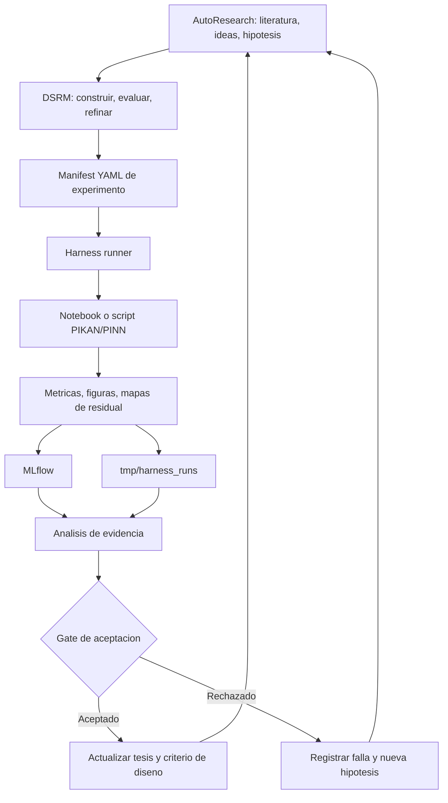

# Como implementar Harness + MLflow + AutoResearch en el proyecto PIKAN

Fecha: 2026-07-09

## Idea central

La forma mas limpia de hacerlo es separar responsabilidades:

- DSRM es la metodologia de investigacion del protocolo.
- AutoResearch es la capa de automatizacion asistida para investigar, formular hipotesis, revisar literatura, ejecutar experimentos y redactar evidencia.
- Harness loop es el mecanismo operativo que convierte cada hipotesis en una iteracion ejecutable.
- MLflow es el libro de evidencia: guarda parametros, metricas, artefactos, decisiones y comparaciones.
- Kanban/agile ligero es la gestion diaria: que se intenta, que corre, que se revisa, que se acepta y que entra al documento.

En pocas palabras: DSRM dice por que iteramos; AutoResearch organiza el ciclo completo de investigacion; Harness ejecuta cada ciclo; MLflow demuestra que paso; Kanban mantiene el avance controlado.

## Arquitectura propuesta



## Como se trabaja una iteracion

Cada iteracion debe tener una hipotesis concreta. No empezamos con "probar focalizacion adaptativa" porque eso es demasiado amplio. Empezamos con algo falsable:

> Si se reponderan los puntos de colocacion usando el residual fisico local cada N epocas, entonces el residual medio en regiones criticas baja frente a PIKAN base en al menos dos semillas, sin aumentar el costo mas de 1.5x.

Despues se convierte esa hipotesis en un `experiment_manifest.yaml`:

- problema: heat 1D, Burgers, Helmholtz, Navier-Stokes simplificado, piezoelectrico;
- baseline: PINN, PIKAN, cPIKAN u otra variante;
- mecanismo: sin focalizacion, residual-based, variation-based, gradient/activation-based;
- semillas;
- metricas objetivo;
- criterio de aceptacion;
- artefactos esperados.

El harness ejecuta el experimento o llama el notebook/script parametrizado. Al terminar, registra:

- snapshot de la configuracion;
- estado de ejecucion;
- metricas;
- figuras;
- resumen;
- decision preliminar;
- enlace a MLflow si esta disponible.

## AutoResearch dentro del flujo

AutoResearch no debe tomar decisiones finales por su cuenta. En este proyecto conviene usarlo como L2: AI ejecuta subtareas, humano verifica.

Sus tareas utiles son:

- buscar y resumir papers de PINNs, KANs, PIKANs, RAR, hp-VPINNs, focalizacion, active learning y FEM;
- convertir papers en hipotesis experimentales;
- revisar logs y corridas fallidas;
- detectar patrones de falla;
- proponer variaciones acotadas;
- redactar notas de resultados;
- auditar que cada afirmacion del documento tenga soporte en paper, MLflow run o figura.

Sus limites:

- no acepta resultados cientificos sin revision humana;
- no cambia el modelo central sin gate;
- no decide que una hipotesis queda demostrada;
- no inventa citas ni referencias;
- no promueve una figura al documento si no tiene configuracion y run asociado.

## Roles recomendados

No necesitas muchos agentes. Tres o cuatro bastan:

- Orquestador: mantiene la hipotesis, decide que archivo/script correr y aplica gates.
- Literature scout: busca papers, crea notas y propone conexiones con el protocolo.
- Experiment analyst: lee MLflow y resume comparaciones baseline vs candidato.
- Report verifier: revisa si las afirmaciones del texto estan soportadas por evidencia.

El orquestador es el unico que puede proponer pasar de una fase a otra. Tu o tu asesor siguen teniendo la decision final.

## Estructura de carpetas recomendada

```text
codigo/
  harness_loop/
    experiment_manifest.yaml
    run_experiment.py
    README.md
notebooks/
  PIKAN-Warmup/
reports/
  harness_mlflow_viability_plan.md
  harness_autoresearch_implementation_guide.md
tmp/
  harness_runs/
mlruns/
  ...
PIKAN-Vault/
  ...
```

El ideal es que cada experimento tenga:

```text
tmp/harness_runs/H001/<timestamp>/
  manifest_snapshot.yaml
  run_summary.json
  decision_note.md
  figures/
```

y su equivalente en MLflow.

## Paso a paso inmediato

1. Escoger un primer problema canonico: por ejemplo Heat 1D.
2. Convertir el notebook base PIKAN en un script parametrizable o usar ejecucion parametrizada de notebook.
3. Completar `codigo/harness_loop/experiment_manifest.yaml` con profundidad, ancho, grid, epocas, puntos de colocacion y semillas reales.
4. Instalar MLflow cuando se quiera tracking completo: `python -m pip install mlflow pyyaml`.
5. Ejecutar el baseline con dos semillas.
6. Registrar curvas de perdida, error relativo, residual medio, residual en region critica y tiempo.
7. Ejecutar una primera variante de focalizacion residual.
8. Comparar contra gate:
   - mejora en al menos dos configuraciones;
   - costo menor o igual a 1.5x;
   - estabilidad no empeora;
   - mejora localizada en region dificil;
   - artefactos completos.
9. Si pasa, se acepta como evidencia para la tesis.
10. Si falla, se registra como direccion rechazada y AutoResearch propone una hipotesis ajustada.

## Como se conecta con el plan del protocolo

- Fase 1: AutoResearch ayuda a cerrar literatura, problemas e hipotesis.
- Fase 2: Harness + MLflow dejan reproducible el baseline.
- Fase 3: canonical PDEs sirven para validar que el loop funciona.
- Fase 4: problemas oscilatorios/multiescala prueban si la focalizacion ayuda donde el sesgo espectral pesa mas.
- Fase 5: dominio acoplado/piezoelectrico prueba si el mecanismo conserva utilidad en complejidad fisica mayor.
- Fase 6: MLflow + notas de rechazo/aceptacion producen condiciones de uso y limitaciones.
- Fase 7: Report verifier revisa que el documento final no afirme mas de lo que la evidencia permite.

## Primer milestone concreto

El primer milestone no debe ser "tener todo el sistema". Debe ser:

> Ejecutar un baseline PIKAN canonico con dos semillas, registrarlo con el harness, guardar artefactos, y producir una decision reproducible de aceptacion o rechazo.

Cuando eso funcione, el resto crece de forma natural: primero una variante de focalizacion, despues comparaciones, despues dominios mas dificiles.

## Fuentes base

- Harness loops: https://lilianweng.github.io/posts/2026-07-04-harness/
- Multi-agent design: https://research.google/pubs/multi-agent-design-optimizing-agents-with-better-prompts-and-topologies/
- Multi-agent systems: https://claude.com/blog/building-multi-agent-systems-when-and-how-to-use-them
- Multi-agent research engineering: https://www.anthropic.com/engineering/multi-agent-research-system
- AutoResearch AI: https://arxiv.org/abs/2605.23204
- AutoResearchBench: https://arxiv.org/abs/2604.25256
- MLflow: https://github.com/mlflow/mlflow

