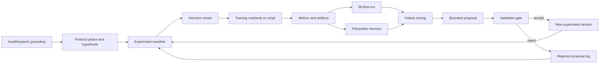

# Harness loops for adaptive PIKAN experimentation

Date: 2026-07-09

## Executive viability

The idea is viable and fits the protocol well. The protocol already frames the thesis as Design Science Research Methodology (DSRM): build, evaluate, and refine a computational artifact through falsifiable experimental hypotheses. A harness loop gives that DSRM cycle an operational form: plan an experiment, run it, observe metrics and artifacts, mine failures, propose bounded changes, validate against baseline/regression criteria, and either accept or reject the change.

The harness should not replace the scientific method in the protocol. It should make the method executable and auditable. In this project, the active artifact remains the adaptive focalization mechanism over PIKANs; the harness is the experiment-management layer around it.

Recommended viability level: high for experiment orchestration and reproducibility; medium for automated self-improvement; low for fully autonomous changes to model code without human approval.

## Protocol alignment

The protocol defines:

- General objective: design and experimentally integrate an adaptive focalization mechanism over Physics-Informed Kolmogorov-Arnold Networks (PIKANs).
- Specific objectives: build PIKAN baselines, evaluate adaptive focalization based on internal model signals, and characterize the mechanism in a coupled piezoelectric problem.
- Methodology: DSRM, falsifiable hypotheses, progressive PDE domains, reproducible Python/Jupyter implementation, PyTorch/pykan/DeepXDE where useful, and MLflow for hyperparameters, model configuration, metrics, execution time, spatial residual distribution, and artifacts.
- Plan: seven partially overlapping phases, from literature closure and hypotheses, through baselines and three evaluation levels, to consolidation and final writing.

Harness loops add the missing operational glue between "iteration" and "evidence":

1. DSRM cycle -> harness iteration.
2. Hypothesis -> experiment manifest.
3. Evaluation metrics -> MLflow tracked metrics and artifacts.
4. Refinement -> bounded proposal with acceptance gates.
5. Plan of work -> PM board with phase gates and evidence reviews.

## Source synthesis

Lilian Weng defines a harness as the system around a base model that controls workflow, tools, context, memory, artifacts, and evaluation. Her post emphasizes workflow automation, filesystem-backed persistent memory, subagents/backend jobs, context engineering, and self-improving harness loops that mine weaknesses, propose bounded edits, and validate them before acceptance. Source: https://lilianweng.github.io/posts/2026-07-04-harness/

Google Research's MASS work argues that multi-agent design depends strongly on prompts and topology, and that strong systems can emerge from simpler, pruned design spaces. For this thesis, that means start with a simple orchestrator and a few specialized roles rather than a large agent swarm. Source: https://research.google/pubs/multi-agent-design-optimizing-agents-with-better-prompts-and-topologies/

Anthropic's multi-agent guidance says multi-agent systems are justified when they solve context pollution, parallelization, or specialization problems, and warns that coordination can cost 3-10x more tokens than a single-agent setup. For this project, use multiple agents only for separable tasks: literature extraction, experiment analysis, failure clustering, and report checking. Source: https://claude.com/blog/building-multi-agent-systems-when-and-how-to-use-them

Anthropic's research-system engineering post supports an orchestrator-worker pattern, durable memory/checkpoints, tracing, robust evals, human review, and careful handling of stateful agent behavior. This maps directly to long experiment cycles where runs may fail, resume, or produce misleading partial success. Source: https://www.anthropic.com/engineering/multi-agent-research-system

MLflow currently positions itself as an open-source AI engineering platform for agents, LLMs, and ML models, with experiment tracking, observability/tracing, evaluation, prompt management, and model lifecycle tools. For this thesis, the core role remains experiment tracking, plus optional tracing for agent/harness decisions. Source: https://github.com/mlflow/mlflow

AutoResearch should be treated as the broader research-automation frame around the harness, not as a replacement for DSRM. The 2026 AutoResearch AI survey defines AutoResearch as workflow-level scientific automation across literature grounding, hypothesis formation, experimentation, validation, and reporting, while emphasizing that current systems still struggle with reproducibility, provenance, weak-direction rejection, and accountable scientific closure. For this thesis, the appropriate autonomy level is human-verified AI execution: AI may search, summarize, plan, run bounded experiments, and draft notes, but the researcher keeps authority over hypothesis acceptance, methodological validity, and final claims. Source: https://arxiv.org/abs/2605.23204

AutoResearchBench is useful as a warning signal: complex scientific literature discovery remains difficult for agents, especially when the answer requires multi-step search, broad coverage, and fine-grained paper selection. This supports a conservative design: use AI literature agents to gather candidates and produce structured notes, but require human or advisor verification before a paper becomes part of the protocol or thesis argument. Source: https://arxiv.org/abs/2604.25256

## Proposed architecture

## AutoResearch layer

AutoResearch is the outer research workflow. In this project it should coordinate five research conditions:

1. Literature grounding: maintain a traceable set of papers, notes, and claims.
2. Hypothesis formation: convert literature gaps and failed runs into falsifiable experiment hypotheses.
3. Experimentation and tool use: execute bounded runs through the harness and notebooks/scripts.
4. Feedback, validation, and review: compare MLflow evidence against acceptance gates.
5. Reporting and knowledge communication: promote only verified results into the thesis, figures, and presentations.

This layer should operate at a conservative L2 autonomy level: human-led direction with AI-executed subtasks and human-verified scientific closure.

## Experiment loop

Each iteration should follow this sequence:

1. Define: select protocol phase, domain level, baseline, hypothesis, expected effect, and falsification condition.
2. Execute: run the notebook/script with a frozen config and seed set.
3. Observe: log training curves, validation error, physical residual, spatial residual/error maps, wall-clock time, memory/cost notes, and generated figures.
4. Diagnose: classify failure modes such as instability, no localized improvement, residual displacement, cost explosion, or poor transfer to a harder domain.
5. Propose: allow only bounded changes to focalization parameters, sampling/refinement policy, architecture size, loss weights, or training schedule.
6. Validate: accept only if improvement appears in at least two independent configurations and does not regress baseline metrics or cost thresholds.
7. Record: write MLflow logs and a filesystem record so the project can resume and the final thesis can trace conclusions to evidence.

## MLflow integration contract

Use one MLflow experiment per protocol domain level:

- `pikan_harness_canonical_pdes`
- `pikan_harness_oscillatory_multiscale`
- `pikan_harness_coupled_physics`

Use one MLflow run per concrete configuration. Suggested tags:

- `protocol_phase`
- `domain_level`
- `hypothesis_id`
- `artifact_version`
- `baseline_family`
- `focalization_family`
- `decision_status`: `candidate`, `accepted`, `rejected`, `needs_review`
- `failure_pattern`

Suggested params:

- PDE/problem name, dimensionality, boundary/initial condition spec.
- Model family: PINN, PIKAN, cPIKAN, KAN variant.
- Network depth/width/grid/order.
- Collocation points and sampling policy.
- Focalization signals: residual, local variation, internal activation/gradient signal, spatial error proxy.
- Loss weights, optimizer, scheduler, seed, epoch budget.

Suggested metrics:

- `relative_l2_error`
- `physics_residual_mean`
- `physics_residual_p95`
- `critical_region_residual_mean`
- `critical_region_error`
- `stability_score`
- `wall_time_sec`
- `cost_proxy`
- `accepted_gate_score`

Suggested artifacts:

- `config.yaml`
- `run_summary.json`
- loss curve plots
- residual heatmaps
- prediction/reference/error maps
- failure analysis note
- proposal note
- final decision note

## PM methodology combination

Use DSRM as the research methodology, MLflow as the experiment evidence system, and a lightweight agile/Kanban layer as the operational project-management system.

Recommended board columns:

- Backlog: candidate hypotheses, papers, problem domains, implementation ideas.
- Ready: hypothesis and acceptance/falsification criteria are explicit.
- Running: experiment is executing or queued.
- Review: MLflow artifacts exist and need interpretation.
- Accepted: evidence satisfies gate.
- Rejected: hypothesis or proposal failed gate.
- Writing: result is being converted into thesis text/figure.
- Done: result is traceable in MLflow and reflected in the manuscript.

Recommended cadence:

- Weekly planning: choose at most 2-3 experiment hypotheses.
- Midweek check: verify runs are logging and no compute budget is being wasted.
- Weekly review: inspect MLflow results, accept/reject proposals, update thesis notes.
- Phase gate review: move from canonical -> oscillatory -> coupled only when the protocol's evidence threshold is met.

AutoResearch cadence:

- Literature refresh: once per week, update candidate papers and summarize only papers relevant to active hypotheses.
- Claim audit: before writing a thesis section, connect each claim to a paper, MLflow run, or generated artifact.
- Weak-direction review: every two weeks, list rejected hypotheses and why they failed, so failed experiments become methodological evidence rather than lost work.
- Provenance check: before each phase gate, verify that run IDs, configs, figures, and notes can reconstruct the evidence trail.

## Multi-agent usage policy

Use a single-agent harness by default. Add subagents only when one of these is true:

- Context protection: a subtask produces long logs, papers, or traces that should be summarized before entering the main reasoning context.
- Parallelization: several independent configurations or literature angles can be reviewed at once.
- Specialization: a verifier can check metrics, citations, or artifacts without needing full project context.

Good subagent roles for this thesis:

- Literature scout: summarizes relevant PINN/KAN/PIKAN/RAR/FEM references into structured notes.
- Experiment analyst: reads MLflow runs and detects improvement/regression patterns.
- Failure miner: clusters failed runs into recurrent failure modes.
- Report verifier: checks that claims in the thesis text are supported by MLflow run IDs and figures.

Avoid agent roles that directly edit core model code without human approval.

## Acceptance gates

An iteration is accepted only if:

- It improves the target metric in at least two independent configurations, matching the protocol.
- It does not introduce a disproportionate compute cost versus baseline.
- It preserves or improves stability.
- It produces localized improvement in the target difficult region, not only a global metric gain.
- It has complete MLflow and filesystem artifacts.
- It survives a held-out or harder setting when the phase requires generalization.

## Implementation outputs added

This report is paired with:

- `codigo/harness_loop/experiment_manifest.yaml`: editable experiment contract for protocol-aligned runs.
- `codigo/harness_loop/run_experiment.py`: lightweight runner that records iterations locally and logs to MLflow when installed.
- `codigo/harness_loop/README.md`: usage notes for adapting the runner to notebooks or training scripts.

## Immediate next steps

1. Convert the current Heat/Navier-Stokes notebooks into callable training scripts or parameterized notebook executions.
2. Add one canonical PDE experiment manifest using the baseline PIKAN.
3. Run 2-3 seeds with MLflow tracking.
4. Add the first adaptive focalization candidate.
5. Compare baseline versus candidate using the acceptance gates above.
6. Promote only accepted results into the thesis narrative.
