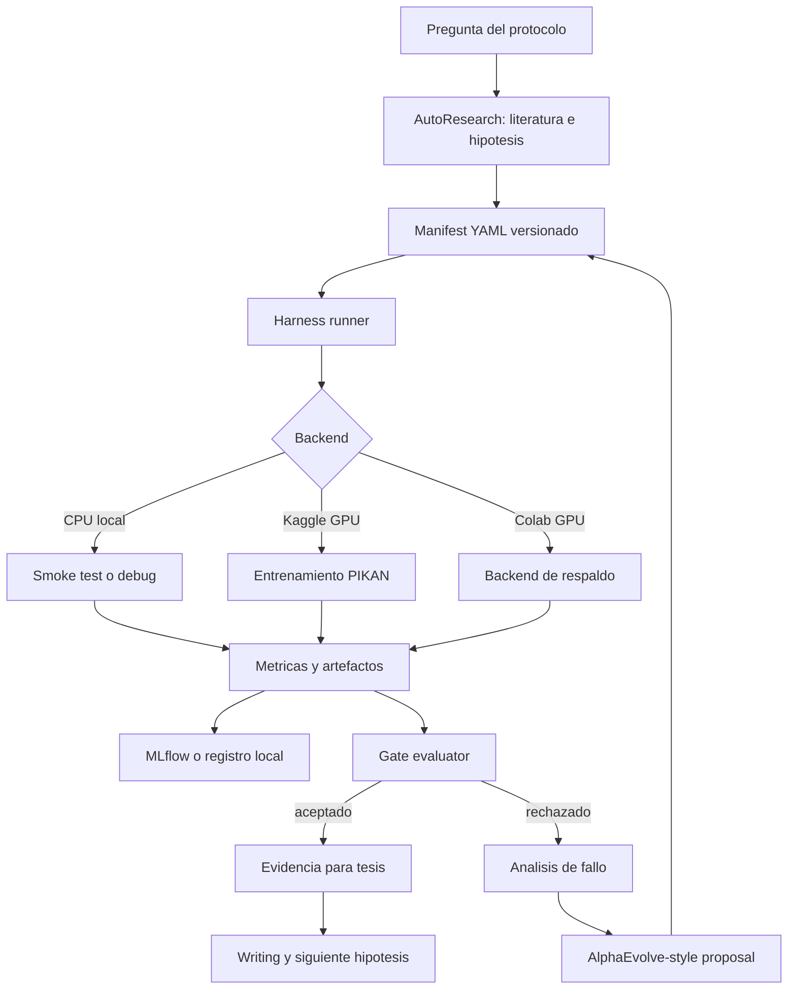

# Plan maestro de implementacion: Research/Production para PIKAN

Fecha: 2026-07-19

## 1. Decision ejecutiva

El proyecto debe pasar de un ciclo manual basado en notebooks a un pipeline reproducible de investigacion y produccion:

```text
pregunta del protocolo
  -> hipotesis falsable
  -> manifiesto versionado
  -> script ejecutable
  -> Harness local o remoto
  -> metricas y artefactos
  -> gate de aceptacion
  -> evidencia aceptada o fallo documentado
  -> escritura y nueva hipotesis
```

La PIKAN no debe entrenarse siempre en la computadora local. El equipo local se usa para validar contratos, probar configuraciones pequenas, revisar codigo y analizar resultados. Las corridas de entrenamiento que consumen horas se ejecutan en un backend GPU remoto, inicialmente Kaggle y como respaldo Colab.

La computadora local sigue siendo el centro de control. Kaggle aporta el acelerador; no se convierte en la fuente de verdad del experimento. El mismo manifiesto, el mismo script y el mismo contrato de salida deben poder ejecutarse localmente y en Kaggle.

## 2. Objetivo del sistema

El objetivo no es automatizar la ciencia completa ni permitir que un agente cambie libremente el modelo. El objetivo es eliminar el trabajo repetitivo que distrae de las decisiones de mayor carga cognitiva:

- matematica y formulacion de la PDE;
- fisica del sistema y condiciones de frontera;
- interpretacion de resultados;
- seleccion de hipotesis relevantes;
- escritura y defensa de las conclusiones.

El pipeline absorbe:

- preparar y ejecutar configuraciones;
- repetir semillas;
- guardar parametros, tiempos y artefactos;
- comparar baseline contra candidato;
- detectar fallos recurrentes;
- proponer cambios acotados;
- verificar gates;
- producir notas trazables para la tesis.

## 3. Alineacion con el protocolo

El protocolo estudia un mecanismo de focalizacion adaptativa sobre PIKANs. La contribucion no debe presentarse como una afirmacion universal de que PIKAN supera a PINN. El eje cientifico es estudiar si las senales del modelo pueden ayudar a identificar y representar mejor regiones fisicamente dificiles.

El pipeline respeta esa posicion:

| Elemento del protocolo | Implementacion en el pipeline |
| --- | --- |
| DSRM | Ciclo construir, evaluar, refinar y comunicar |
| Hipotesis falsable | Seccion `hypothesis` del manifiesto |
| PDE canonica | Primera etapa con referencia analitica o numerica clara |
| Problemas oscilatorios/multiescala | Segunda etapa para probar el valor de la focalizacion |
| Sistema acoplado | Etapa final, por ejemplo piezoelectricidad |
| Metricas fisicas | Error local, residual local y distribucion espacial |
| Reproducibilidad | Semillas, configuracion congelada, script y artefactos |
| Refinamiento | Propuestas acotadas evaluadas por gates |
| Comunicacion | Decision notes, figuras y vinculos a los runs |

## 4. Analisis de metodologias y frameworks

### DSRM: metodologia academica

DSRM es la metodologia principal del trabajo. Define por que se construye un artefacto, como se evalua y como se refina. El artefacto es el mecanismo de focalizacion adaptativa integrado en PIKAN.

DSRM no ejecuta procesos, no guarda logs y no decide que script correr. Es la estructura de validez de la tesis.

### AutoResearch: capa de investigacion asistida

AutoResearch organiza el ciclo completo alrededor del experimento:

- busqueda y organizacion de literatura;
- extraccion de conceptos y referencias;
- generacion de hipotesis falsables;
- planificacion de experimentos;
- lectura de resultados;
- agrupacion de fallos;
- preparacion de notas y borradores;
- auditoria de afirmaciones frente a la evidencia.

Se adopta un nivel L2: la IA ejecuta subtareas y prepara propuestas, pero el investigador conserva la autoridad sobre la validez cientifica, la aceptacion de hipotesis y las afirmaciones finales.

AutoResearch no sustituye DSRM. DSRM determina el metodo; AutoResearch reduce el trabajo operativo y documental.

### Harness: sistema operativo del ciclo

El Harness es la capa que conecta una hipotesis con una ejecucion verificable. Administra contexto, herramientas, memoria persistente, trabajos remotos, artefactos y evaluaciones.

En este proyecto el Harness debe:

1. leer un manifiesto;
2. crear un directorio inmutable para el run;
3. ejecutar un script con variables de entorno estandarizadas;
4. guardar una copia del manifiesto;
5. recoger `metrics.json`, figuras y `decision_note.md`;
6. escribir `run_summary.json`;
7. enviar los resultados a MLflow o al registro local;
8. invocar gates y generar una decision;
9. dejar el estado listo para una nueva iteracion.

El Harness no debe contener la matematica de la PDE. Esa responsabilidad pertenece a los modulos de modelo y entrenamiento.

### AlphaEvolve: busqueda acotada de candidatos

AlphaEvolve aporta una idea de optimizacion: generar candidatos, evaluarlos con una funcion objetiva y conservar solo los que superan un criterio.

La adaptacion segura para esta tesis es:

- el manifiesto define un espacio de cambios permitido;
- el agente propone candidatos dentro de ese espacio;
- cada candidato se ejecuta con el mismo protocolo;
- un evaluador automatico calcula gates;
- el investigador revisa los candidatos aceptables;
- solo despues se promueve un cambio al codigo principal.

Cambios permitidos inicialmente:

- politica de muestreo de puntos de colocacion;
- umbral de residual;
- peso de focalizacion;
- frecuencia de actualizacion de la grilla;
- calendario de pesos de la perdida;
- presupuesto de entrenamiento;
- semillas y configuracion de repeticion;
- completitud del logging.

Cambios bloqueados:

- definicion de la PDE;
- solucion de referencia;
- metrica de evaluacion;
- gates de aceptacion;
- bibliografia;
- afirmaciones de la tesis;
- cambios irreversibles al modelo central sin revision.

### MLflow: libro de evidencia

MLflow no es la metodologia ni el orquestador. Es el registro de parametros, metricas, artefactos y decisiones.

Debe registrar como minimo:

- problema, dominio y version del codigo;
- familia de modelo y arquitectura;
- numero de puntos de colocacion;
- senales y parametros de focalizacion;
- optimizador, scheduler, epocas y semillas;
- error global y local;
- residual global y local;
- estabilidad entre semillas;
- tiempo de entrenamiento y proxy de costo;
- mapas de prediccion, error y residual;
- nota de decision y estado del gate.

Se puede comenzar con almacenamiento local de MLflow. El servidor remoto de MLflow no es necesario para el primer milestone.

### Multi-agent, MASS y patrones de Anthropic

Los trabajos de Google y Anthropic justifican usar agentes especializados solo cuando exista una ganancia clara por paralelismo, aislamiento de contexto o verificacion independiente.

Roles recomendados:

- orquestador: mantiene manifiesto, estado y gates;
- explorador de literatura: genera notas con fuentes verificables;
- analista experimental: compara runs y metricas;
- minero de fallos: agrupa errores y sugiere patrones;
- verificador: revisa que cada afirmacion tenga fuente o run asociado.

No se necesita un enjambre permanente. Para una tarea pequena, un solo agente y un comando son preferibles. Los agentes pueden usar modelos gratuitos o locales segun disponibilidad, porque la ejecucion de la PIKAN y la ejecucion del modelo de lenguaje son capas separadas.

### Kanban y Stage-Gate: gestion del trabajo

DSRM no reemplaza la gestion diaria. Se recomienda combinarlo con un Kanban ligero y gates de fase.

Columnas:

```text
Backlog -> Ready -> Running -> Review -> Accepted/Rejected -> Writing -> Done
```

Reglas:

- maximo dos o tres hipotesis activas por semana;
- ninguna corrida entra a `Running` sin hipotesis y gate;
- ninguna conclusion entra a `Writing` sin run y artefactos;
- el paso a una PDE mas compleja requiere evidencia de la etapa anterior;
- una direccion rechazada se conserva como resultado, no se borra.

## 5. Arquitectura objetivo



Separacion de responsabilidades:

| Capa | Responsabilidad | Debe vivir donde |
| --- | --- | --- |
| OpenCode/Codex | Preparar tareas, revisar archivos y coordinar | Local |
| Harness | Ejecutar, guardar estado y recoger salidas | Local y remoto |
| Modelo de lenguaje | Analizar, proponer y verificar | Local o proveedor free tier |
| PIKAN | Entrenar y evaluar PDE | CPU local pequena o GPU remota |
| MLflow | Registrar evidencia | Local al inicio |
| Kaggle/Colab | Acelerar entrenamiento | Remoto |

## 6. El problema del tiempo de ejecucion

Una PIKAN real puede tardar demasiado en CPU por diferenciacion automatica, numero de puntos de colocacion, costo de las funciones de arista y calculo de derivadas. Por eso el pipeline debe tener niveles de ejecucion.

| Nivel | Uso | Equipo | Criterio |
| --- | --- | --- | --- |
| T0 | Validar YAML, imports, shapes, contrato de salida | CPU local | Segundos |
| T1 | Debug con red y malla pequenas | CPU local | Minutos |
| T2 | Smoke test de entrenamiento | Kaggle GPU o Colab | Minutos |
| T3 | Resultado experimental con varias semillas | Kaggle GPU | Decenas de minutos u horas |

El resultado de T0/T1 no es evidencia cientifica. Sirve para evitar desperdiciar una sesion GPU por un error de rutas, dimensiones o logging.

Para acelerar:

- precomputar la solucion de referencia y las mallas fijas;
- separar `train`, `evaluate` y `plot` para no graficar cada epoca;
- registrar curvas cada cierto numero de epocas, no en cada paso;
- usar batch de puntos de colocacion cuando la formulacion lo permita;
- comenzar con pocos puntos y ampliar solo despues de pasar el smoke test;
- usar early stopping basado en residual y validacion;
- limitar el numero de candidatos por iteracion;
- fijar semillas y reutilizar configuraciones que ya pasaron el contrato;
- guardar checkpoints solo en intervalos definidos;
- descargar a local solo los artefactos necesarios;
- ejecutar las semillas como trabajos independientes cuando el backend lo permita.

La regla practica es: cualquier corrida que no tenga una hipotesis, un presupuesto y un gate no merece GPU.

## 7. Flujo local hacia Kaggle

El flujo propuesto desde VSCode/OpenCode es:

```text
VSCode/OpenCode
  -> valida manifest
  -> ejecuta T0/T1 local
  -> empaqueta script + manifest + dependencias
  -> crea job Kaggle
  -> Kaggle ejecuta T2/T3 con GPU
  -> descarga metrics/artifacts
  -> Harness ingesta resultados
  -> MLflow y gate
```

El paquete remoto debe incluir:

```text
tmp/kaggle_jobs/H001/<job_id>/
  kernel-metadata.json
  run_kaggle.py
  experiment_manifest.yaml
  requirements.txt
  codigo/
```

El script remoto debe escribir exactamente las mismas salidas que el script local:

```text
metrics.json
decision_note.md
run_summary.json
figures/
checkpoints/   # solo si el experimento los necesita
```

Kaggle requiere credenciales y acceso de red para enviar o descargar jobs. Eso se configura una sola vez en la computadora local. La arquitectura queda lista aunque el primer uso se haga manualmente desde Kaggle; la automatizacion de submit/download es una fase posterior.

## 8. Estrategia de costo minimo

La estrategia mas barata y razonable es:

- codigo y control de versiones: Git local;
- desarrollo y T0/T1: Python local en CPU;
- tracking inicial: MLflow local o registro JSON versionado;
- entrenamiento pesado: GPU gratuita de Kaggle;
- respaldo: Colab gratuito;
- modelos de lenguaje: OpenCode con modelos disponibles en free tier o modelos locales pequenos para tareas simples;
- modelo de lenguaje fuerte: reservarlo para literatura dificil, decisiones ambiguas o revision final;
- almacenamiento remoto: conservar solo checkpoints y artefactos necesarios;
- no contratar un servidor MLflow ni una GPU cloud hasta que el experimento demuestre que las cuotas gratuitas son insuficientes.

El costo real del plan gratuito no es cero garantizado: depende de cuotas, tiempos de sesion, disponibilidad de GPU, limites de almacenamiento y cambios del proveedor. Por eso el pipeline debe soportar interrupciones, reanudacion y ejecuciones parciales.

No se necesita una API de Claude para iterar codigo sencillo. El Harness debe aceptar cualquier backend de agente y tratarlo como una herramienta de propuesta y analisis, no como parte de la evidencia cientifica.

## 9. Contrato de un experimento

Cada experimento debe tener:

1. identificador estable, por ejemplo `H001`;
2. fase del protocolo;
3. hipotesis, efecto esperado y condicion de falsacion;
4. problema y solucion de referencia;
5. arquitectura y presupuesto;
6. semillas;
7. metricas y gates;
8. backend esperado;
9. artefactos obligatorios;
10. estado de decision.

El contrato ya esta representado en [experiment_manifest.yaml](../codigo/harness_loop/experiment_manifest.yaml). El runner expone:

- `HARNESS_MANIFEST`: ruta del manifiesto usado;
- `HARNESS_RUN_DIR`: directorio donde el script debe escribir sus salidas.

El contrato minimo de salida es:

```json
{
  "relative_l2_error": 0.0,
  "physics_residual_mean": 0.0,
  "critical_region_residual_mean": 0.0,
  "stability_score": 0.0,
  "wall_time_sec": 0.0
}
```

Los valores reales dependeran de la implementacion PIKAN. El `train_stub.py` existente solo prueba el contrato del pipeline y no debe presentarse como resultado cientifico.

## 10. Gates cientificos

Una variante de focalizacion se acepta solamente cuando:

- mejora el objetivo local en al menos dos configuraciones independientes;
- conserva o mejora estabilidad;
- no supera el limite de costo definido frente al baseline;
- muestra mejora espacial, no solo una mejora global;
- conserva todos los artefactos requeridos;
- funciona en un conjunto retenido o en una condicion mas dificil cuando la fase lo exige;
- el resultado queda vinculado a un run, configuracion, semilla y figura.

Un aumento del error global puede ser aceptable solo si la pregunta de la fase estudia explicitamente el intercambio entre error global y mejora en regiones criticas. Esa decision debe quedar escrita, no inferirse despues de ver los resultados.

## 11. Roadmap de implementacion

### Fase 0 - Contratos y estructura

Estado: iniciada y funcional.

Entregables existentes:

- manifiesto de experimento;
- runner Harness local;
- snapshot del manifiesto por run;
- `metrics.json` y `decision_note.md`;
- evaluador de gates;
- propuesta AlphaEvolve-style acotada;
- ejemplo de script sin notebook.

Criterio de salida: un script puede ejecutarse sin notebook y generar un registro completo.

### Fase 1 - Migracion del primer notebook

Objetivo: convertir el baseline de Heat 1D en un script real parametrizable.

Entregables:

- modulo de PDE y solucion de referencia;
- modulo PIKAN/PINN base;
- funcion de entrenamiento;
- funcion de evaluacion;
- generador de figuras;
- `train_heat_1d.py`;
- configuracion sin estado oculto de notebook.

Criterio de salida: el mismo comando produce el mismo tipo de resultados en T1 y T2.

### Fase 2 - Baseline reproducible

Objetivo: establecer la linea base antes de implementar focalizacion.

Entregables:

- dos semillas como minimo;
- metricas globales y locales;
- curvas de perdida;
- mapas de prediccion, error y residual;
- tiempos y memoria o proxy de costo;
- registro MLflow local.

Criterio de salida: baseline aceptado como referencia o fallo documentado con causa.

### Fase 3 - Backend Kaggle

Objetivo: ejecutar la misma corrida en GPU sin duplicar codigo.

Entregables:

- empaquetador de job;
- `kernel-metadata.json`;
- script remoto;
- comandos `package-kaggle`, `submit-kaggle`, `download-kaggle` e `ingest-remote-output`;
- validacion de hashes de manifest y script;
- manejo de job interrumpido y descarga parcial.

Criterio de salida: un H001 remoto puede ser descargado e ingresado al mismo gate local.

### Fase 4 - Primera focalizacion adaptativa

Objetivo: probar una sola familia de focalizacion, preferiblemente guiada por residual, antes de introducir senales internas mas complejas.

Entregables:

- implementacion baseline/candidato con bandera explicita;
- parametros en el manifiesto;
- comparacion con mismas semillas y presupuesto;
- analisis de regiones criticas;
- propuesta o rechazo documentado.

Criterio de salida: una conclusion limitada y defendible sobre el caso canonico.

### Fase 5 - Problemas oscilatorios o multiescala

Objetivo: evaluar si la focalizacion aporta donde el sesgo espectral y las variaciones locales son relevantes.

Entregables:

- problema con referencia confiable;
- metricas de frecuencia o resolucion local cuando sean pertinentes;
- comparacion global/local;
- sensibilidad a semillas e hiperparametros.

Criterio de salida: evidencia a favor, en contra o condicionada sobre el mecanismo.

### Fase 6 - Sistema acoplado

Objetivo: llevar el mecanismo a piezoelectricidad u otro sistema acoplado viable.

Entregables:

- definicion fisica documentada;
- referencia numerica o analitica;
- campos y residuos por componente;
- focalizacion evaluada por region y por campo;
- analisis de limites.

Criterio de salida: el mecanismo se caracteriza en un caso de mayor complejidad sin sobreafirmar generalidad.

### Fase 7 - Consolidacion y escritura

Objetivo: transformar la evidencia en tesis.

Entregables:

- tabla de hipotesis aceptadas y rechazadas;
- matriz claim -> paper/run/figure;
- figuras reproducibles;
- condiciones de uso;
- limitaciones y amenazas a la validez;
- instrucciones para repetir los resultados.

Criterio de salida: cada afirmacion experimental puede reconstruirse desde un run y cada afirmacion bibliografica desde una fuente verificable.

## 12. Estado actual del repositorio

Ya estan disponibles:

- [plan de viabilidad Harness + MLflow](harness_mlflow_viability_plan.md);
- [guia Harness + AutoResearch](harness_autoresearch_implementation_guide.md);
- [blueprint del pipeline](research_production_pipeline_blueprint.md);
- [manifiesto de experimento](../codigo/harness_loop/experiment_manifest.yaml);
- [runner Harness](../codigo/harness_loop/run_experiment.py);
- [CLI del pipeline](../codigo/research_pipeline/pipeline.py);
- [guia operativa](../codigo/research_pipeline/README.md).

El pipeline ya valida manifiestos, ejecuta un script local, crea registros de run, ingiere metricas, evalua presencia de metricas obligatorias y genera propuestas acotadas. Todavia falta conectar el entrenamiento PIKAN real y construir el backend Kaggle.

## 13. Orden de trabajo recomendado

El orden concreto es:

1. congelar el alcance de Heat 1D y su referencia;
2. migrar el baseline a script real;
3. pasar T0 y T1 local;
4. crear el backend Kaggle;
5. ejecutar T2 con una semilla;
6. corregir estabilidad y logging;
7. ejecutar dos semillas para H001;
8. implementar una sola focalizacion residual;
9. ejecutar baseline y candidato con identico presupuesto;
10. aceptar o rechazar con gates;
11. solo despues ampliar a oscilatorio/multiescala;
12. reservar el sistema acoplado para cuando exista evidencia de que el pipeline y las metricas funcionan.

## 14. Riesgos y controles

| Riesgo | Control |
| --- | --- |
| PIKAN tarda horas en CPU | T0/T1 local y T2/T3 en Kaggle |
| Cuota GPU agotada | smoke tests pequenos, checkpoints y Colab de respaldo |
| Notebook contiene estado oculto | script parametrizable y manifiesto obligatorio |
| Agente cambia demasiado codigo | edit surface bloqueada y revision humana |
| Mejora global oculta un fallo local | mapas y metricas por region critica |
| Se confunde focalizacion con remuestreo | registrar por separado senal, politica y puntos |
| Resultado no se puede repetir | snapshot, hash, seed, entorno y artefactos |
| Se sobreinterpreta una corrida | dos configuraciones independientes y gate de estabilidad |
| Multi-agent agrega coordinacion | usar un agente salvo que haya paralelismo o verificacion real |
| El modelo de lenguaje inventa soporte | auditoria claim -> fuente o run |

## 15. Criterio de exito del sistema completo

El sistema estara listo para uso de investigacion cuando el investigador pueda expresar una hipotesis en el manifiesto y obtener, sin abrir un notebook:

- una corrida local de validacion;
- una corrida GPU remota con la misma configuracion;
- metricas comparables;
- figuras y notas;
- un gate automatico;
- una propuesta de siguiente iteracion si falla;
- una ruta trazable desde el resultado hasta el texto de la tesis.

El sistema no estara terminado por tener muchos agentes o muchas integraciones. Estara terminado cuando reduzca trabajo repetitivo sin reducir el control cientifico.

## 16. Fuentes analizadas

- [Protocolo base del proyecto](../escrito/protocoloFinal-it0/protocoloGrad_RM.pdf)
- [Harness engineering y self-improving loops](https://lilianweng.github.io/posts/2026-07-04-harness/)
- [Google Research: multi-agent design, prompts y topologias](https://research.google/pubs/multi-agent-design-optimizing-agents-with-better-prompts-and-topologies/)
- [Anthropic: cuando y como usar sistemas multi-agent](https://claude.com/blog/building-multi-agent-systems-when-and-how-to-use-them)
- [Anthropic: sistema de investigacion multi-agent](https://www.anthropic.com/engineering/multi-agent-research-system)
- [DeepMind: AlphaEvolve](https://deepmind.google/blog/alphaevolve-a-gemini-powered-coding-agent-for-designing-advanced-algorithms/)
- [AutoResearch AI](https://arxiv.org/abs/2605.23204)
- [AutoResearchBench](https://arxiv.org/abs/2604.25256)
- [MLflow](https://github.com/mlflow/mlflow)

## Conclusion

La combinacion viable para este proyecto es:

```text
DSRM = validez academica
AutoResearch = investigacion asistida
Harness = ejecucion y memoria del ciclo
AlphaEvolve = exploracion acotada de candidatos
MLflow = evidencia experimental
Kanban/Stage-Gate = control del avance
Kaggle = acelerador GPU gratuito sujeto a cuotas
OpenCode = interfaz local para coordinar el trabajo
```

La primera meta concreta no es automatizar toda la tesis. Es ejecutar un baseline PIKAN real, sin notebook, con dos semillas, en GPU remota, y producir una decision reproducible. A partir de ahi, la focalizacion adaptativa puede evaluarse como una secuencia de experimentos comparables y no como una cadena de ejecuciones manuales dificiles de reconstruir.
