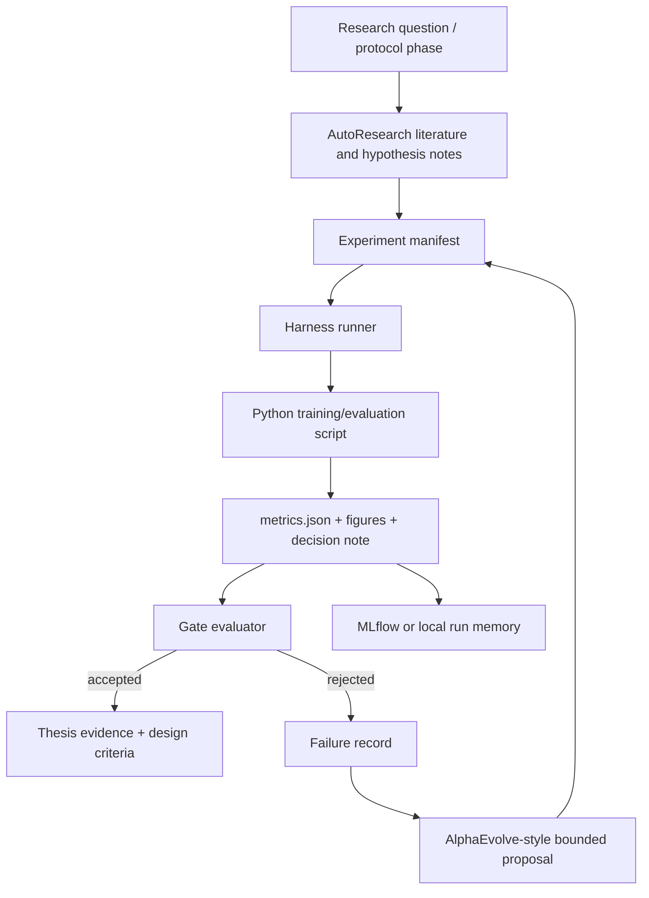

# Research/production pipeline blueprint

Date: 2026-07-10

## Purpose

The project should move away from notebook-driven experimentation and toward a
reproducible research/production pipeline. Notebooks can remain as scratchpads,
but they should not be the source of thesis evidence.

The desired loop is:

```text
manifest -> executable script -> harness run -> metrics/artifacts -> gate -> accepted/rejected evidence -> writing
```

This keeps the researcher focused on physics, mathematics, interpretation, and
writing, while the pipeline handles repetitive code execution, bookkeeping,
comparison, and traceability.

## Methodology stack

- DSRM: the academic research methodology. Build, evaluate, refine.
- AutoResearch: the assisted research workflow around literature, hypothesis
  creation, experiment planning, and evidence-to-writing translation.
- Harness engineering: the execution system that gives agents/tools memory,
  context, artifact handling, evaluation, and reproducibility.
- AlphaEvolve-style search: bounded candidate generation over code/configs,
  evaluated objectively before any change is accepted.
- Multi-agent orchestration: used only when it reduces context load,
  parallelizes independent work, or adds verifier specialization.
- MLflow/local evidence store: the tracking layer for metrics, params, tags,
  artifacts, decisions, and comparison.

## Architecture



## What replaces notebooks

Each notebook should be migrated into three pieces:

- `src` or `codigo` module: reusable PDE/model/training code.
- experiment manifest: parameters, hypothesis, gates, expected artifacts.
- executable script: a thin entrypoint that reads the manifest and writes
  metrics/artifacts into `HARNESS_RUN_DIR`.

Notebook cells become functions. Visualizations become artifact writers.
Manual notes become decision notes. Hidden state becomes explicit config.

## AlphaEvolve adaptation

AlphaEvolve works because it combines LLM-generated candidate programs with
automated evaluators and an evolutionary loop. For this thesis, the safe version
is not "let the model freely rewrite everything." The safe version is:

1. Keep an explicit bounded edit surface.
2. Generate candidates only inside that surface.
3. Run candidates through the same harness.
4. Accept only if gates pass.
5. Require human review before core model changes are promoted.

Good edit surfaces for this project:

- collocation sampling policy;
- residual threshold;
- focalization weight;
- grid update policy;
- loss weight schedule;
- training schedule;
- seed plan;
- artifact logging completeness.

Do not let the evolutionary loop change:

- PDE definitions without review;
- reference solution generation;
- evaluation metrics;
- acceptance gates;
- thesis claims;
- bibliography.

## Multi-agent policy

Use the smallest useful team:

- Orchestrator: owns manifest, run, gate, and decision status.
- Literature scout: finds and summarizes papers into structured notes.
- Experiment analyst: reads metrics and artifacts, explains failures.
- Verifier: checks claims against runs, figures, and sources.

The agent system should reduce cognitive load, not create extra coordination
work. If a task fits in one context and one command, keep it single-agent.

## First milestone

The first production milestone is not a large experiment. It is:

> Run a canonical PIKAN baseline without opening a notebook, produce
> `metrics.json`, create a harness run record, evaluate gates, and generate a
> decision note.

Once that works, add Kaggle/Colab execution as a backend. The pipeline should
already be reproducible before it becomes remote.

## Files added

- `codigo/research_pipeline/pipeline.py`: CLI for validation, local runs, gates,
  and bounded evolution proposals.
- `codigo/research_pipeline/examples/train_stub.py`: non-notebook script
  contract example.
- `codigo/research_pipeline/README.md`: operational commands.

## Sources

- Harness loops: https://lilianweng.github.io/posts/2026-07-04-harness/
- AlphaEvolve: https://deepmind.google/blog/alphaevolve-a-gemini-powered-coding-agent-for-designing-advanced-algorithms/
- MASS: https://research.google/pubs/multi-agent-design-optimizing-agents-with-better-prompts-and-topologies/
- Anthropic multi-agent systems: https://claude.com/blog/building-multi-agent-systems-when-and-how-to-use-them
- Anthropic research system: https://www.anthropic.com/engineering/multi-agent-research-system

